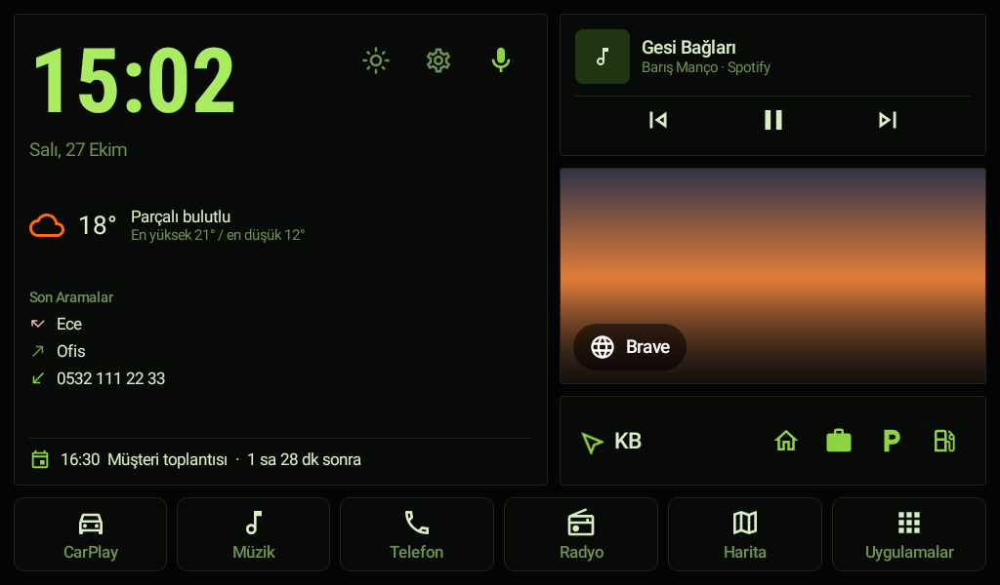
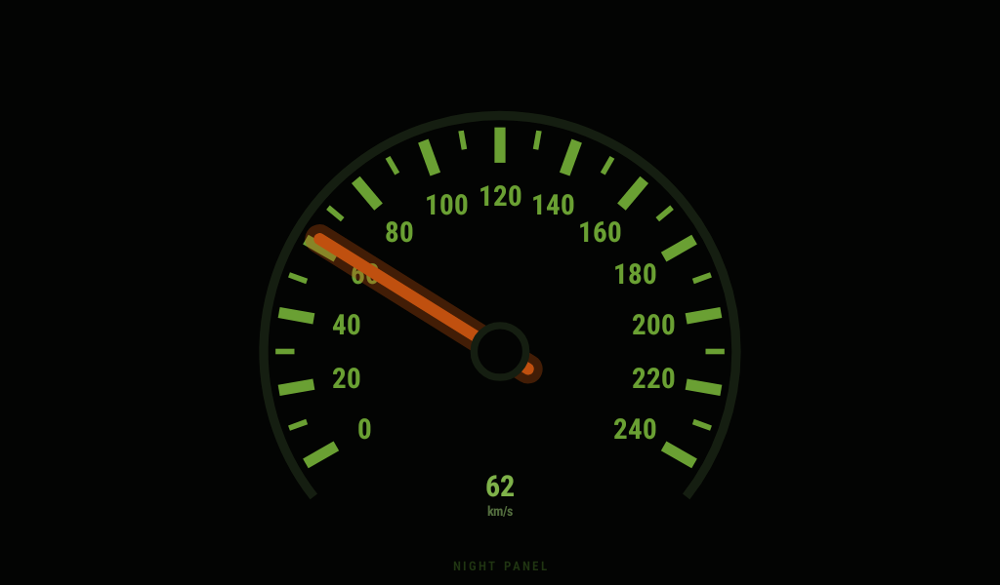
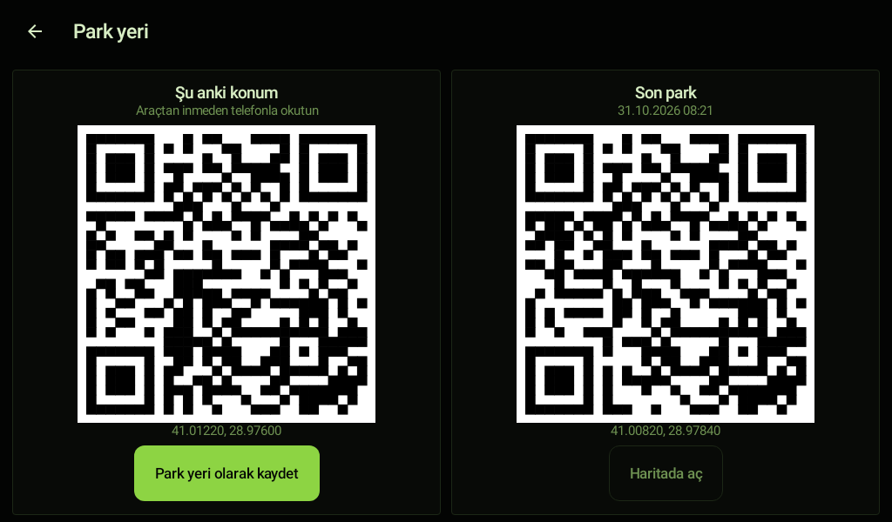
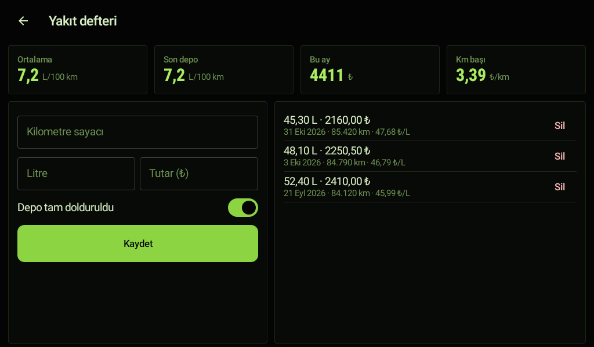
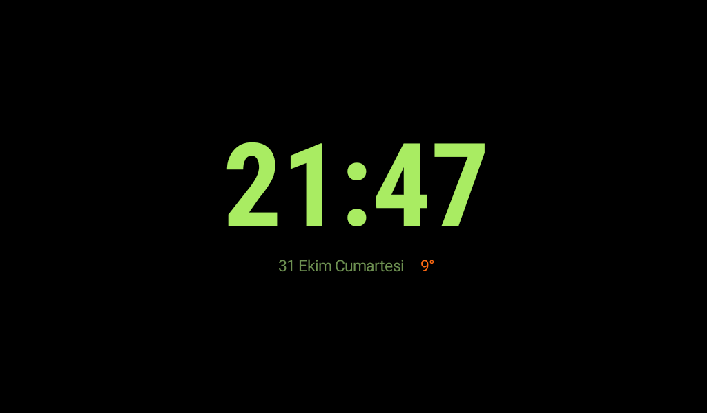
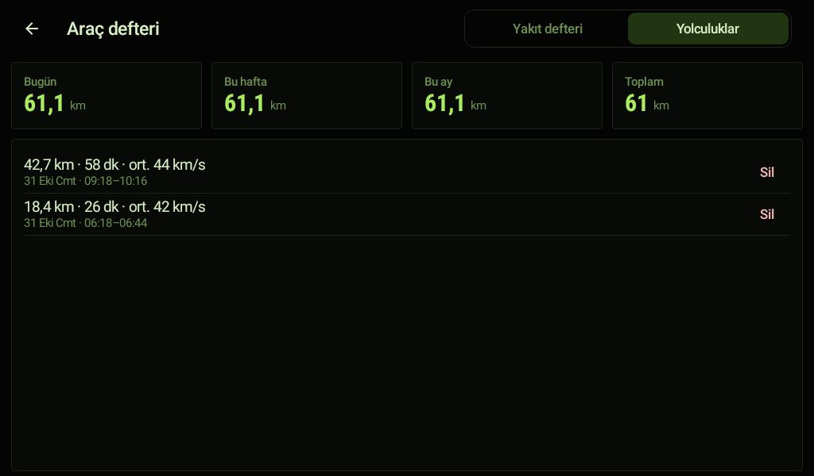

# Kokpit (Tiguan)

Araç multimedya cihazı (MT8227L / FYT / TS, Android 8.1–13) için klasik, yeşil
ışıklı **kokpit temalı** ana ekran. Cihazda hiçbir yerde marka adı ya da logo yoktur. [yorulmazsinan/kokpit-car-launcher](https://github.com/yorulmazsinan/kokpit-car-launcher)
(Apache 2.0) üzerine kuruludur; orijinal belge: [README-kokpit-orijinal.md](README-kokpit-orijinal.md).

Root gerekmez, cihaz yazılımına dokunulmaz. Her değişiklik geri alınabilir.

## Eklenenler

### 1. Klasik Kokpit teması (varsayılan, Saab 9-3 gösterge panelinden esinlenildi)

| Ana ekran | Night Panel |
|---|---|
|  |  |

- Siyah gösterge yüzü, Saab'ın **yeşil gösterge aydınlatması**, **turuncu ibre**.
- Ana ekrandaki hız kartı, 0–240 km/s'lik **analog Saab hız göstergesine** dönüşür:
  10'ar km/s çentikler, 20'şerlik yeşil rakamlar, parlayan turuncu ibre, siyah göbek,
  altında SID tarzı dijital hız.
- **NIGHT PANEL** düğmesi (hız kartının sol üstü): Saab'daki gibi her şey kararır, yalnızca
  hız göstergesi kısık ışıkla kalır. Ekrana dokununca kokpit geri gelir.
- Köşeler sivri (havacılık paneli havası). Ayarlar → Görünüm'den diğer temalara geçilebilir.

### Karşılama videoları (yaz / kış)
Uygulamanın içinde iki karşılama videosu gelir: **yaz** (gün batımında orman yolu) ve
**kış** (karlı yol). Varsayılan açılış modu **Mevsime göre**: dış sıcaklık biliniyorsa
≤10 °C kış, ≥18 °C yaz videosu; arada ya da hava durumu yoksa aya göre (Kasım–Mart kış).
Kontak açılınca oynar, dokununca geçilir. Ayarlar → Açılış Videosu'ndan başka moda
geçebilir, ikisinden birini sabitleyebilir, USB'den kendi videolarınızı ekleyebilirsiniz.
Videolar ünite için 1024×576'ya küçültüldü (~2 MB).

### Tek dokunuşla parlaklık
Ana ekranda saatin yanındaki **güneş** simgesi: Gece (en kısık) · − · kaydırıcı · + ·
Gündüz (en parlak). Değişiklik anında uygulanır; panel birkaç saniye sonra kendi kapanır.
İlk kullanımda bir kez "sistem ayarlarını değiştirme" izni istenir.

### Araç özellikleri (Tiguan için eklenenler)
Ana ekrandaki yön şeridinde dört düğme: **Ev · İş · P · Yakıt**.

- **Otomatik gece/gündüz parlaklığı:** gün batınca ekran gece seviyesine kısılır, gün
  doğunca gündüz seviyesine açılır (saatler konumun hava durumundan; yoksa 07:00/19:00).
  ☀ ile yapılan elle ayar bir sonraki gün batımı/doğumuna kadar korunur. İsteğe bağlı:
  gün batınca Night Panel kendiliğinden açılır. Ayarlar → Parlaklık.
- **Park yeri:** kontak kapanınca son GPS konumu kendiliğinden kaydedilir. **P**'ye
  dokununca şu anki konumun ve son park yerinin **QR kodu** çıkar; araçtan inmeden
  telefonla okutursanız harita telefonda açılır.
- **Yakıt defteri:** her yakıt alışında kilometre, litre ve tutarı fişten girin. Ortalama
  ve son depo tüketimi (L/100 km, iki tam depo arası), bu ayki harcama, km başı maliyet.
  Depoyu tam doldurmadıysanız "Depo tam dolduruldu"yu kapatın; hesap bozulmaz.
- **Ev / İş tek dokunuş:** dokununca Harita düğmesine atanmış uygulamada (Google Haritalar,
  Waze, Yandex) yol tarifi başlar. **Uzun basınca aracın şu anki konumu Ev/İş olarak
  kaydedilir**; adres yazmak için Ayarlar → Araç → Ev ve İş.

| Park yeri | Yakıt defteri |
|---|---|
|  |  |

### Kontak açılınca müziği sürdür
Kontak kapandığında çalan kaynak (radyo, Bluetooth müzik ya da Spotify gibi bir uygulama)
hatırlanır ve kontak açılınca, karşılama videosundan sonra yeniden başlar. Durmadan önce
durdurduğunuz müzik kapalı kalır; iPhone takılıyken (CarPlay) devreye girmez.

### Asistanla "Eve götür" / "İşe götür"
Asistana "eve götür", "işe gidelim", "ofise" dediğinizde kayıtlı Ev/İş adresine yol tarifi
başlar. Kayıtlı değilse asistan nasıl kaydedileceğini söyler.

### Araç defteri: yolculuklar
Kontak açılıştan kapanışa her yolculuk (200 m üstü) kendiliğinden kaydedilir: km, süre,
ortalama hız. Bugün / bu hafta / bu ay / toplam km. Ana ekranda **Yakıt** düğmesi →
*Yolculuklar* sekmesi. Elektrik kesilse de en çok bir dakikalık yol kaybolur.

### Bekleme ekranı
Araç dururken ana ekrana 2 dakika (ayarlanabilir: 1/2/5/10) dokunulmazsa büyük saat,
tarih ve dış sıcaklık gösterilir; ekran izi kalmasın diye her dakika hafifçe kayar.
Dokununca ya da araç hareket edince ana ekran geri gelir.

### Telefondan yönetim: Kokpit Kumanda (Bluetooth)
Ayarlar → **Telefondan yönet** ekranındaki QR iki yoldan açılır:
- **Telefonun tarayıcısı (Wi-Fi):** telefon ünitenin ağındaysa (hotspot ya da Kokpit'in
  kendi ağı) telefon kamerasıyla okutun; panel tarayıcıda açılır.
- **Kokpit Kumanda uygulaması (Bluetooth):** Wi-Fi gerekmez. Telefonun üniteyle
  Bluetooth'ta eşleşmiş olması yeterli. Uygulamada **QR'ı okut** → PIN → panel açılır.
  Ünite bir Wi-Fi'da değilse QR yalnızca Kumanda'yla açılır.

Kurulum: [Releases](https://github.com/oguzcelik93/kokpit/releases/latest) sayfasından
`kokpit-kumanda-<sürüm>.apk`'yı telefona indirip kurun ("bilinmeyen uygulamalar" izni
istenir). İlk açılışta "Yakındaki cihazlar" (Bluetooth) izni sorulur.

Güvenlik kuralları iki yolda da aynıdır, çünkü ikisi de ünitedeki aynı panele gider:
panel yalnızca ünitede biri açınca çalışır; QR her açılışta yeni bir 128 bit anahtar taşır;
ardından araç sahibinin PIN'i gerekir (5 yanlış denemede giderek uzayan kilit, PIN yalnızca
ünitede sıfırlanır); panel 15 dakika boşta kalınca ya da 1 saat dolunca kapanır ve açıkken
ünitede uyarı görünür; yalnızca sabit işlem listesi vardır (uygulama kurma, kabuk komutu,
sistem ayarı, dosya gezme yok). Bluetooth tarafında ünite yalnızca **güvenli RFCOMM** ile
dinler: sadece eşleşmiş telefonlar bağlanabilir, bağlantı şifrelidir. Panel kapalıyken bu
kapı yalnızca iki şey alır: "Bağlan" isteği (ünitede **İzin ver**'e dokunulmadan hiçbir şey
açılmaz) ve hatırlanan telefonun paylaştığı rota/fotoğraf. Kumanda kendi başına hiçbir şey
yapamaz; telefonda yalnızca 127.0.0.1'i dinleyen küçük bir köprüyle panel sayfasını
ünitenin sunduğu gibi gösterir.

**Kumanda 1.1 ile gelenler (Kokpit 0.16):**
- **Bağlan (QR'sız):** bir kez QR ile bağlandıktan sonra Kumanda üniteyi hatırlar.
  "Bağlan"a dokunun, ünitede "… bağlanmak istiyor · İzin ver" çıkar; tek dokunuş yeter.
- **Bu telefonu hatırla:** PIN ekranındaki kutu işaretliyse o telefon bir daha PIN girmez
  (yalnızca Bluetooth'tan ve yalnızca o telefonun kendi bağlantısından; anahtarın kendisi
  ünitede değil, özeti tutulur). Yeni bir telefon her zaman PIN'le başlar. Ünitede
  Telefondan yönet → Hatırlanan telefonlar'dan tek tek unutulur; PIN sıfırlanınca hepsi unutulur.
- **Paylaş → Kokpit'e gönder:** Google Haritalar/Waze/Yandex'ten bir yer ünitede "Yola çık"
  diye bekler; galeriden fotoğraflar albüme düşer (telefonda küçültülüp gönderilir).
- **Kumanda sekmesi:** yolcu için ses, önceki/sonraki parça, oynat/duraklat ve parlaklık.
- **Fişten doldur:** yakıt fişi telefonda okunur (ML Kit, internetsiz); litre, tutar ve
  tarih forma gelir, siz kilometreyi yazıp kaydedersiniz.
- **Arabam nerede?** (isteğe bağlı): kontak kapanıp telefonun üniteyle bağlantısı kopunca
  telefon kendi konumunu not eder ve "Aracınız burada park edildi · Haritada aç" bildirimi
  gösterir. Ünitenin GPS'i fix almadığı için konum telefondan alınır ve telefonda kalır.
- **Sürücü profilleri:** Ev/İş, kart fotoğrafı, müziğin kaldığı yer ve parlaklık,
  Bluetooth'tan bağlı telefona göre değişir (Ayarlar → Araç ve kontak).
- **Bakım hatırlatmaları:** muayene, sigorta, kasko, yağ değişimi (tarih ve km), kışlık/yazlık
  lastik. Araç defteri → Bakım'da ya da paneldeki Araç sekmesinde girilir; 30 gün (yağ için
  1.000 km) kala ana ekranda ve panelde görünür. Km yakıt defterindeki son kayıttan alınır.

Bluetooth Wi-Fi'dan yavaştır: Kumanda büyük fotoğrafları göndermeden önce telefonda
küçültür (en uzun kenar 1920 px); karşılama videosu yüklemek birkaç dakika sürebilir.

### Pist modu ve araç verileri
Ana ekrandaki bayrak düğmesi **Pist modu**'nu açar: büyük hız ve maksimum hız, tek dokunuşla
başlangıç çizgisi ("Çizgi burası") ve tur zamanları (son, en iyi, fark), 0–100 ölçümü,
ünitede ivme sensörü varsa G ölçer. Ölçümler GPS iledir; ünite GPS almıyorsa çalışmaz.
Ekran açık kalır. **Tüm araç verileri** ekranı ünitenin araçtan hangi değerleri gerçekten
verdiğini canlı gösterir. Yağ sıcaklığı, turbo basıncı ve devir için yerler hazır; Bluetooth
OBD adaptörüyle dolacaklar.

### USB bellekle kurulum ve güncelleme
**İlk kurulum:** [Releases](https://github.com/oguzcelik93/kokpit/releases/latest) sayfasından `kokpit-<sürüm>.apk`'yı indirip USB belleğe kopyalayın, belleği takın, cihazın dosya
yöneticisinden APK'ya dokunun ("bilinmeyen kaynaklar" sorulursa izin verin). Ev tuşu →
**Kokpit → Her zaman**.

**Güncelleme:** yeni `kokpit.apk`'yı (adı `kokpit` ile başlayan herhangi bir `.apk`)
belleğin köküne ya da `Kokpit/` klasörüne koyup takın. Kokpit sürümü kendisi okur; daha
yeniyse dosyayı cihaza kopyalar ve ana ekranın üstünde "Güncelleme hazır" yazar. Bellek o
anda çıkarılabilir. Dokunup **Kur** deyin. Ayarlar → Hakkında → Güncelleme → *USB bellekte
ara* ile elle de aranabilir.

**USB bellek takılı kalmak zorunda değil.** Kokpit cihaza kurulur; karşılama videoları
APK'nın içindedir, USB'den eklenen videolar cihaza kopyalanır. Bellek yalnızca kurulum,
güncelleme ve gerektiğinde kurtarma dosyası (`KOKPIT-KURTARMA`) için takılır.

> Güncellemenin üst üste kurulabilmesi için her sürüm **aynı anahtarla** imzalanmalıdır.
> İmza farklıysa Android "uygulama yüklenmedi" der; o zaman Kokpit kaldırılıp yeniden
> kurulur ve ayarları sıfırlanır. İmza anahtarı depoda tutulmaz (bkz. `app/build.gradle.kts`).

**İnternetten güncelleme (GitHub):** ünite internete bağlıyken Kokpit kontak açılışlarında
(en çok 6 saatte bir) bu deponun son sürümünü kontrol eder
(`releases/latest/download/version.json`), APK'yı indirir, SHA-256 ile doğrular ve
"Güncelleme hazır" yazar; **Kur** demeniz yeterli. Sessiz kurulum bilerek yoktur: bir
sürüm her zaman sizin onayınızla kurulur.

### Yeni sürüm yayınlamak (geliştirici)
1. `app/build.gradle.kts`: `versionCode`'u artırın, `versionName`'i değiştirin.
2. Açıklamalı etiket gönderin: `git tag -a v0.8.0 -m "Bu sürümde: …" && git push origin v0.8.0`
3. "Sürüm yayınla" iş akışı testleri çalıştırır, APK'yı kasadaki anahtarla imzalar ve
   Releases'e `kokpit-0.8.0.apk` + `version.json` olarak koyar. Aynı anahtarla imzalanan
   telefon uygulaması da `kokpit-kumanda-<sürüm>.apk` olarak eklenir (sürümü
   `kumanda/build.gradle.kts`'te; Kumanda değiştiyse orada da `versionCode`'u artırın).

**İmza anahtarı (bir kez):** anahtar depoda değil, GitHub'ın gizli kasasında durur.
1. GitHub → Settings → Developer settings → Fine-grained tokens → *Generate new token*:
   yalnızca bu depo, izin: **Secrets → Read and write**, süre 1 gün.
2. Depo → Settings → Secrets and variables → Actions → *New repository secret*:
   ad `ANAHTAR_TOKEN`, değer token.
3. Actions → **İmza anahtarı oluştur (bir kez)** → *Run workflow*. Anahtar ve şifresi
   üretilip kasaya kendiliğinden konur, hiçbir yerde görünmez.
4. `ANAHTAR_TOKEN` secret'ını ve token'ı silin.

| Bekleme ekranı | Yolculuklar |
|---|---|
|  |  |

### 2. Hızlandırma
**Bilgisayarsız, adım adım (Ayarlar → Sistem → Hızlandırma):** ilk açılışta ana ekranda
"Cihazı hızlandır" yazar. Dört adım, her biri tek dokunuş:
1. Belleği boşalt.
2. Gereksiz uygulamaları kapat: dokununca sıradaki uygulamanın sayfası açılır, *Devre dışı
   bırak* deyip geri dönersiniz; kalan sayısı azalır.
3. Animasyonları 0,5× yap: Geliştirici seçenekleri açılır, üç ölçek 0,5× yapılır (gizliyse
   "Yapı numarası"na 7 kez dokunun). ADB izni verilmişse tek dokunuşla.
4. Kokpit'i uyutma: Android'in pil kısıtlamasından muaf tutar; müzik sürdürme, park yeri ve
   yolculuk kaydı aksamaz.

Dağıtılan APK **release** derlemesidir (R8 ile küçültülmüş, debug derlemesinden belirgin
biçimde hızlı, ~7 MB).

**Cihazda (Ayarlar → Sistem → Hızlandırma), ayrıca:**
- *Belleği şimdi boşalt*: boştaki arka plan uygulamalarını kapatır (CarPlay, Bluetooth,
  radyo gibi çalışan servislere dokunmaz).
- *Animasyonlar*: Kapalı / 0,5× / Orijinal (bir kerelik ADB izni gerekir, aşağıda).
- *Gereksiz uygulamalar*: araçta işe yaramayan bilinen uygulamalar (MTK Logger,
  DuraSpeed, ekran koruyucular, yazdırma servisleri…). Dokununca Android'in kendi
  uygulama sayfası açılır, **Devre dışı bırak** dersiniz. Hiçbir şey silinmez.

**Bilgisayardan ADB ile (`araclar/`):**
```bash
./kur.sh kokpit93.apk          # kurar, ana ekran yapar, animasyon iznini verir
./hizlandir.sh                 # güvenli listeyi kapatır, animasyonları 0.5x yapar
./hizlandir.sh listeler/ek.txt # daha cesur liste (kullanmadıklarınızı bırakın)
```
Windows'ta aynı adlı `.bat` dosyaları. Betik her çalıştırmada önceki durumu hem cihaza
(`/data/local/tmp/kokpit-yedek`) hem bilgisayara (`araclar/yedek/`) yedekler; yalnızca
**kendi kapattığı** uygulamaları kaydeder, önceden kapalı olanlara dokunmaz. Paketler
`pm disable-user` ile kapatılır, asla kaldırılmaz.

### 3. Arka kapı: eski haline döndürme
Bir sorun çıkarsa cihazı fabrika haline döndürmenin beş yolu:

| Yol | Ne zaman |
|---|---|
| **Ana ekranda saate uzun basın** → Kurtarma | Ekran çalışıyor ama bir şeyler ters |
| **USB bellek**: köküne `KOKPIT-KURTARMA` adlı boş dosya | Ekrana dokunamıyorsanız. Güvenli mod + üretici ekranı açılır. Belleğe `KOKPIT-KURTARMA-SONUC.txt` raporu yazılır |
| USB bellek: `KOKPIT-SIFIRLA` | Kokpit ayarlarını sıfırlar (ilk kurulum hali) |
| USB bellek: `KOKPIT-NORMAL` | Güvenli moddan çıkar |
| **Kendiliğinden**: 3 dakikada 3 çökme | Kokpit güvenli moda geçer, ev tuşu üretici ekranına gider |
| **Bilgisayardan**: `./geri-al.sh` | Son hızlandırmayı geri alır. `--hepsi` tümünü, `--fabrika` tümünü + üretici ana ekranını, `--kaldir` bunlara ek Kokpit'i kaldırır |

**Güvenli mod:** Kokpit arka planda hiçbir şey başlatmaz; ev tuşu doğrudan üreticinin
ekranını açar; Kokpit simgesine dokunursanız yalnızca Kurtarma ekranı açılır.
Kurtarma ekranında: üretici ekranını aç, *cihazı eski haline döndür*, ana ekran seçimini
sıfırla, güvenli mod, Kokpit ayarlarını sıfırla, animasyonları geri al, kapatılan
uygulamaları tek tek geri aç, Kokpit'i kaldır.

> USB tetikleyicinin çalışması için Kokpit'e ilk açılışta **depolama izni** verilmelidir.

### 4. Doğrudan CarPlay (Ayarlar → CarPlay bağlantısı)
- Cihazda kurulu CarPlay motorlarını bulur ve sıralar: **cihazın kendi CarPlay'i**
  (PhoneLink / `com.ts.carplayapp`) → ZLink → AutoKit (Carlinkit adaptörü) → EasyConnection.
  Cihazınızın yazılımında yerleşik CarPlay varsa ZLink'e hiç gerek kalmaz.
- iPhone USB'ye takılınca Kokpit seçili motoru **kendisi** açar (ayar: *iPhone takılınca
  CarPlay'i aç*). iPhone'un bağlı olup olmadığı ekranda canlı görünür.
- **Yükleme ekranını atla:** motorun ekranları listelenir; doğrudan CarPlay'e açılan
  ekranı seçerseniz "Loading…" ekranı bundan sonra atlanır.

**Neden ZLink'siz tamamen "uygulamasız" değil?** iPhone CarPlay'i ancak araç ünitesi
Apple'ın **MFi doğrulama çipiyle** kendini kanıtlarsa başlatır. Bu çiple konuşan ve
CarPlay görüntüsünü çözen yazılım kapalı kaynaktır (cihazın kendi CarPlay servisi, ZLink
ya da Carlinkit adaptörünün içindeki yazılım). Sıradan bir Android uygulaması bunu
yeniden yazamaz. Kokpit'in yaptığı: varsa yerleşik CarPlay'i kullanmak, ZLink'in açılış
ekranını atlamak ve her şeyi otomatik başlatmak. Ünitede çip yoksa en sağlam yol bir
Carlinkit tipi kablosuz CarPlay adaptörüdür (AutoKit ile).

## Kurulum
1. APK'yı derleyin (aşağıda) ya da `app-debug.apk`'yı USB belleğe kopyalayıp cihazdan kurun.
2. Ev tuşu → **Kokpit → Her zaman**.
3. İzinleri verin (konum, takvim, arama kaydı, **depolama**).
4. İsteğe bağlı: bilgisayardan `araclar/kur.sh` ve `araclar/hizlandir.sh`.

Uygulama kimliği `io.github.oguzcelik93.kokpit93`; orijinal Kokpit ile yan yana kurulabilir.
Cihazda görünen ad "Kokpit", tema adı "Klasik Kokpit (yeşil)".

## Derleme
```bash
./gradlew :app:testDebugUnitTest :app:assembleDebug
# APK: app/build/outputs/apk/debug/app-debug.apk
./gradlew :kumanda:testDebugUnitTest :kumanda:assembleDebug
# Telefon uygulaması: kumanda/build/outputs/apk/debug/kumanda-debug.apk
```
JDK 17–21 ve Android SDK (platform 37) gerekir; `local.properties` içine `sdk.dir=...`.

## Lisans
Apache 2.0 ([LICENSE](LICENSE)). Orijinal proje: [yorulmazsinan/kokpit-car-launcher](https://github.com/yorulmazsinan/kokpit-car-launcher); bu klasördeki değişiklikler (Saab teması, CarPlay merkezi, hızlandırma, kurtarma, `araclar/`) ona eklenmiştir.
Saab, Saab AB'nin ticari markasıdır; bu proje Saab ile ilişkili değildir, yalnızca
kişisel kullanım için bir görünüm temasıdır ve logo içermez.
